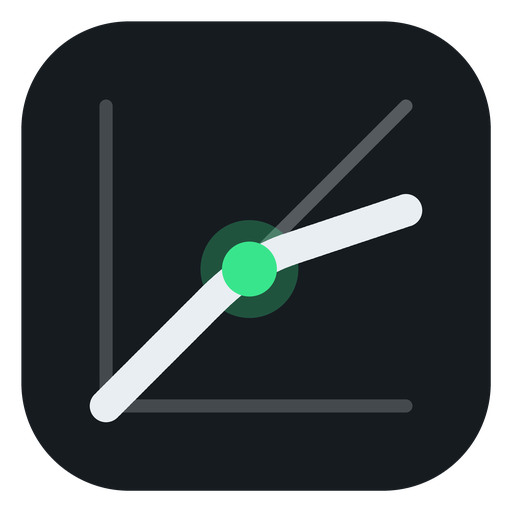

# VoxMix

Compressor + limiter real-time untuk Android, terinspirasi perangkat dbx.
Mic / line-in -> compressor (RMS, soft knee) -> limiter -> output, dengan Oboe
(audio latensi rendah) dan meter gain reduction.

## Cara build di GitHub (tanpa Android Studio)

1. Buat repository baru di github.com.
2. Unggah isi proyek ini ke repo:
   - **Dari komputer:** ekstrak zip, lalu seret semua isinya (termasuk folder
     `.github`) ke halaman repo -> *Add file -> Upload files*.
   - **Dari HP:** unggah `DbxComp.zip` apa adanya (*Add file -> Upload files*),
     lalu *Add file -> Create new file*, namai `.github/workflows/build.yml`,
     tempel isi file `build.yml`, dan commit. Workflow akan mengekstrak zip sendiri.
3. Buka tab **Actions**. Build jalan otomatis setiap ada commit
   (atau klik *Run workflow*). Butuh sekitar 5-10 menit.
4. Setelah hijau, buka run-nya -> bagian **Artifacts** -> unduh `VoxMix-debug-apk`
   -> ekstrak -> pasang `app-debug.apk` di HP (izinkan "install dari sumber tidak dikenal").

## Catatan pemakaian

- Pakai **headphone** atau **audio interface USB**. Mic HP + speaker HP = feedback.
- Pilih perangkat input/output di dalam aplikasi. Untuk latensi terendah: interface USB
  atau headphone berkabel. Bluetooth biasanya 100 ms lebih.
- Aplikasi harus tetap di layar depan; Android membatasi mic di latar belakang,
  jadi audio berhenti otomatis saat aplikasi ditinggal.
- Mode input mic memakai `Unprocessed` supaya AGC/noise suppression bawaan HP mati.
- Limiter tanpa lookahead: puncak sangat cepat dipotong keras di ceiling sebagai
  pengaman, jadi bukan brickwall transparan setara hardware.

## Tata letak

- **Bilah atas tetap** (tidak ikut tergulung): meter IN / GR / OUT, START, REKAM, dan BYP
  (bypass semua efek). Di bawahnya tab: **Sumber**, **Mic**, **Kompresor**, **Reverb**, **Preset**.
- Kontrol dikelompokkan dalam kotak berbingkai. Tombol **i** membuka/menutup teks panduan
  untuk kelompok atau kontrol itu.
- Tombol ON/OFF: ON menyala hijau, OFF redup. BYP memakai oranye karena artinya efek dimatikan.

## Preset dan rekam

- **Preset** disimpan sebagai file JSON di `Documents/DbxComp/Preset` (Android 10+). Isinya
  memakai nama parameter (bukan urutan angka), plus catatan, versi aplikasi, dan model HP.
  Tombol: *Muat*, *Simpan*, *Hapus*, *Bagikan* (kirim file lewat aplikasi lain), *Impor*.
  **Netral (bawaan)** = semua efek mati dan semua gain 0 dB, dipakai sebagai pembanding.
  Preset lama dari versi sebelumnya dipindahkan otomatis ke file saat pertama dibuka.
- Android hanya mengizinkan aplikasi melihat file yang dibuatnya sendiri. Kalau aplikasi dipasang
  ulang, file lama tetap ada di folder tetapi tidak muncul di daftar; pakai *Impor* untuk
  memasukkannya lagi.
- **Rekam:** tekan START, lalu *● REK*. Yang direkam adalah hasil akhir setelah compressor +
  limiter, format WAV 16-bit, di **Music/DbxComp** (Android 10+). Android 9 ke bawah: folder
  milik aplikasi (`Android/data/com.example.dbxcomp/files/...`).
- Setiap rekaman otomatis dibuatkan **file info** dengan nama sama di
  `Documents/DbxComp/Rekaman/<nama>.json`: setelan saat merekam, perangkat input/output,
  mono/stereo, sample rate, dan statistik tiap kanal (puncak, RMS, RMS 100 ms terendah dan
  persentil ke-10 sebagai perkiraan desis). Untuk menakar mic/preamp, rekam **mono dengan
  Rekam A/B**: kanal kiri = suara asli (setelah input gain), kanan = hasil olahan.
  Input stereo memakai mode Camcorder yang pada sebagian HP bisa menambah pengolahan bawaan.

## Logo

Logo: kurva transfer compressor (garis redup = 1:1, garis terang = setelah ditekan)
dengan titik LED hijau di lutut kurva. Ikon adaptif + versi monokrom (tema ikon Android 13+)
ada di `app/src/main/res`; PNG untuk Android 7.0-7.1 ada di folder `mipmap-*`.
Ikon notifikasi layanan tangkap suara internal: `drawable/ic_stat_dbxcomp.xml`.

## Perubahan VoxMix 2.0
- Preset menyimpan konfigurasi global untuk strip A/B/C beserta seluruh parameter Master.
- Halaman Preset menampilkan nilai fader dan status tombol yang sedang aktif.
- Master menyediakan Pre-master EQ (jalur internal/rekaman) dan Output EQ (khusus keluaran, tidak masuk rekaman).
- Tombol volume fisik saat VoxMix aktif di layar mengatur level monitor keluaran saja, terpisah dari pemrosesan dan rekaman.
- Application ID baru: `com.example.voxmix`, sehingga dapat dipasang berdampingan dengan versi lama.
